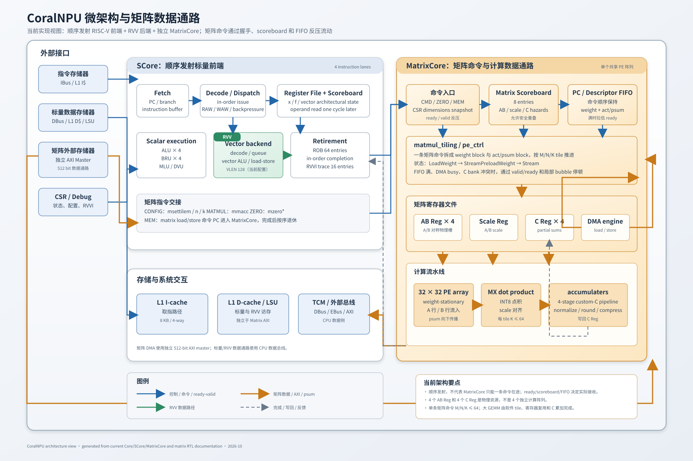

# CoralNPU 微架构图

打开 [`coralnpu_microarchitecture.svg`](coralnpu_microarchitecture.svg) 可以查看可缩放的矢量图，也可以直接把 SVG 导入 PowerPoint。图中按当前代码和文档标出了 SCore、RVV、MatrixCore、MatrixScoreboard、ROB、矩阵 DMA、AB/C 寄存器、PE 阵列和累加器之间的关系。

图里的“在途命令”指 MatrixCore 实际通过 `valid/ready` 接收、但尚未通过 `done` 完成的命令；它与 CPU ROB 中的未退休指令数量是两个不同测量点。4 个 AB Reg 和 4 个 C Reg 是共享 MatrixCore 的物理寄存器资源，也不是 4 个独立 PE 阵列。

当前矩阵命令单条的 `M/N/K` 上限是 64。更大的 GEMM 由软件按 M/N/K 分块，利用 C Reg 保留部分和，并通过 MatrixCore scoreboard、descriptor FIFO 和 DMA 反压保证寄存器复用安全。

2026-10-18 将 CPU ROB 容量由 48 项改为 64 项；矩阵 scoreboard 仍为 8 项，RVVI trace 仍为 16 路。64 项配置的 512x128x512 GEMM 初测为 901.710 MAC/cycle，随后软件优化依次达到 951.035、975.817 和 1002.223 MAC/cycle。最新版本在跨 M tile 且 `tile_m` 不变时也提前下一组 C0，功能、命令握手及波形 profile 校验通过，32768 拍激活连续输入，无组间或跨 M 输入空档。较短 M 尾块仍使用保守顺序，完整回归和综合时序需单独验证。详见[性能对比](../matrix_gemm_899_performance.md#等行数跨-m-提前-c0-后的-1002223-结果)。
