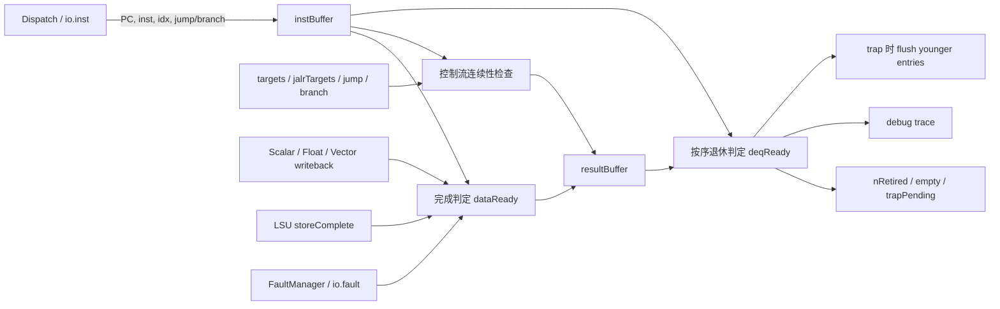
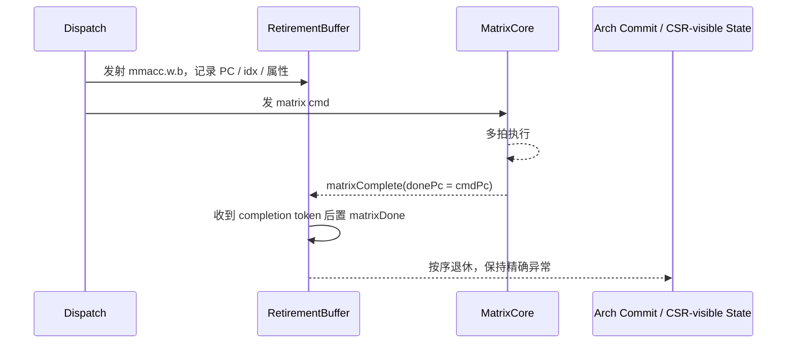
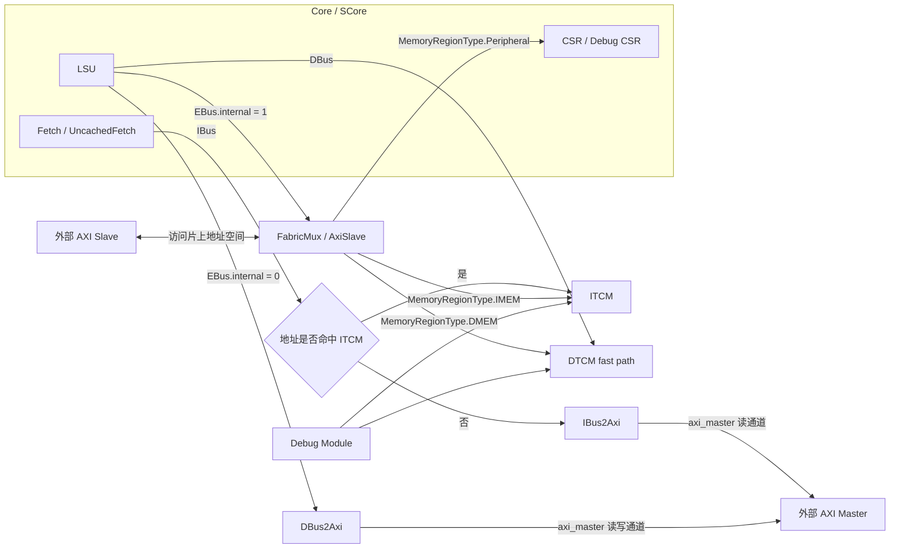

# Coral Matrix Extension 笔记

## 当前进度

- 已完成 matrix 参数初版配置
  - 已在 `hdl/chisel/src/coralnpu/Parameters.scala` 中加入 `enableMatrix / matrixElen / matrixTlen / matrixTrlen` 等参数
- 已完成 `msettile*` 的 Decode 改造
  - 已加入 `msettilemi/msettilem/msettileki/msettilek/msettileni/msettilen`
  - 已用 `matrixCfg` 通路区分 `SET_M / SET_K / SET_N`
  - 已让 immediate 形式通过 `rs1Set` 注入 `uimm10`
  - 已让 `matrixCfg` 与 CSR 一样要求 `retirement_buffer_empty` 后再发射
- 已完成 `msettile*` 从 `Decode -> SCore -> CSR` 的闭环接通
  - 已把 `dispatch.io.matrixCfg` 接入 `csr.io.matrixCfgReq`
  - 已根据 `matrixCfgReq.op + rs1.data` 更新 `xtilem / xtilek / xtilen`
  - 已去掉普通 CSR 写路径对 `xtilem / xtilek / xtilen` 的直接赋值
- 已完成 `msettile*` 的程序级验证
  - 已新增 `tests/cocotb/tutorial/matrix_cfg_program.cc`
  - 已新增 `tests/cocotb/tutorial/matrix_cfg.py`
  - 已覆盖立即数形式、寄存器形式，以及 `M / K / N` 三个维度的改写验证
- 已完成 matrix CSR 面的程序级验证
  - 已新增 `tests/cocotb/tutorial/matrix_csr_program.cc`
  - 已新增 `tests/cocotb/tutorial/matrix_csr.py`
  - 已覆盖 `xmisa / xtlenb / xtrlenb / xalenb`
  - 已覆盖 `xmcsr <-> xmxrm/xmsat/xmfflags/xmfrm/xmsaten` 的别名关系
  - 已覆盖 `xtilem / xtilek / xtilen` 只能由 `msettile*` 修改、普通 CSR 写不会直接改写
  - 已在 Verilator 下跑通 `//tests/cocotb/tutorial:matrix_csr_core_mini_axi_matrix_csr`
  - 已补齐 VCS 目标 `//tests/cocotb/tutorial:vcs_matrix_csr_core_mini_axi_matrix_csr`
- 已完成第一版 `mmacc.w.b` Verilog 原型
  - 已编写 `MatrixPE32Int8.sv / MatrixRegFile.sv / MatrixMacArray.sv / MatrixCore.sv / MatrixCore_tb.sv`
  - 当前阵列规格为 `4x4 PE`，每个 PE 处理 `32` 路 `int8 x int8` 乘法并累加到 `int32`, **500M时钟下,算力为0.512TOPs**
  - 当前 tile / acc 寄存器规格为 `4 x 1024b tile reg` 与 `4 x 512b acc reg`
  - 已在 `/home/wjj/2-NPU/NPU/2-SIM` 下跑通独立 VCS testbench
- 已完成第一版 Chisel matrix 挂壳
  - 已新增 `hdl/chisel/src/coralnpu/matrix/MatrixInterface.scala`
  - 已新增 `hdl/chisel/src/coralnpu/matrix/MatrixCore.scala`
  - 已把 `MatrixCoreWrapper` 以“仿 RVV”的方式挂到 `Core.scala + SCore.scala`
  - 当前已稳定接通 `CSR / busy / cmd`
  - 已为 `mmacc.w.b / mmaccu.w.b / mmaccus.w.b / mmaccsu.w.b` 预留 `Decode -> Dispatch -> MatrixCore` 的 `op` 通路
  - 当前 Verilog `MatrixCore` 真正落地执行的仍只有 `mmacc.w.b`
  - 当前 `debug` 端口仍主要用于 bring-up / preload / readback
- 已完成 matrix compute -> ROB 的 completion token 闭环
  - `MatrixInstCmd` 已携带 `pc`
  - `MatrixCore` 已输出 `donePc`
  - `RetirementBuffer` 已新增 `matrixInstr / matrixComplete`
  - `matrixDone` 已按 `donePc == bufferEntry.addr` 阻止 matrix 指令过早退休
- 已完成 `mmacc.w.b` 的两条 program 级验证
  - `matrix_mmacc_rob`：验证 `mmacc.w.b` 发射后，后继 `msettilem` 必须等到其退休后才能继续发射
  - `matrix_mmacc_arith`：在 VCS 下通过 cocotb backdoor preload/readback，验证 `mmacc.w.b` 的算术结果与独立 `MatrixCore_tb` 黄金值一致
- 已完成 matrix load/store 的 `Decode.scala` 侧工作
  - 已补齐 `ml*/ms*` 指令的解码、`matrixMem` 发射口、`forceSlot0Only` 与 `dispatched` 统计
  - 已补齐 `readsRs1/readsRs2` 与 scoreboard 相关逻辑，其中 whole-register `mlme/msme` 不读取 `rs2`
  - 已修正 whole-register `mlme/msme` 的 `rs2 = 00000` 编码约束
  - 结论：**load/store 在 Decode 内部的识别与发射前端已完成**
- 已开始 matrix load/store 的执行路径接线
  - `MatrixInterface.scala` 已新增：
    - `MatrixMemReq`
    - `MatrixMemExecReq`
    - `Matrix2Lsu / Lsu2Matrix`
  - `SCore.scala` 已开始把 `dispatch.io.matrixMem` 组包后接到 `io.matrixcore.mem`
  - `SCore.scala` 已按当前版本先补：
    - `base := regfile.io.readData(0).data`
    - `stride := Mux(isWhole, 0.U, regfile.io.readData(1).data)`
  - `SCore.scala` 里也已经预留了 `lsu <-> matrixcore` sideband 接线
  - 但当前仍未完成 `MatrixCore(mem) -> LSU -> matrix regfile` 的系统级闭环
  - 真实状态应定义为：
    - **Decode 前端已完成**
    - **SCore / interface scaffold 已开始铺**
    - **MatrixCore / LSU 的执行落地仍未完成**

## 当前阶段结论

- 当前阶段的 matrix CSR 最小可用闭环已经完成
  - 已完成能力 CSR 只读面
  - 已完成 `xmcsr` 与子字段 CSR 的别名语义
  - 已完成 `msettile* -> xtilem / xtilek / xtilen` 的专用写入口
  - 已明确禁止普通 CSR 写路径直接改写 `xtilem / xtilek / xtilen`
- **后续 CSR 仍需要继续补的内容至少包括**
  - `xmsat_set / xmfflags_set` 从矩阵执行单元的运行时回写
  - `xmfrm` 非法值的约束与异常语义
  - `xtilem / xtilek / xtilen` 的边界值、合法范围与非法配置处理
  - `MS` 字段与 `mrelease`
  - `MS=Off` 时 matrix 指令 / matrix CSR 的非法访问判定
  - 如果后续不只支持 `mmi8i32`，还要继续扩展 `xmisa` 的能力位表达
- 当前阶段的 matrix compute 最小闭环也已经完成
  - 已完成 `mmacc.w.b` 的 `Decode -> Dispatch -> MatrixCore -> ROB retirement` 闭环
  - 已完成 program 级“发射/退休顺序”验证
  - 已完成 program 级“算术结果正确性”验证
  - 但当前 program 级算术验证仍依赖 cocotb backdoor preload/readback，不是纯 ISA 端到端闭环
- 当前最主要的缺口已经从“能不能发射/能不能算”转到“数据怎么进来、结果怎么出去”
  - 也就是下一步优先补 `mld / mst` 或等价的矩阵数据搬运路径
- 当前 matrix load/store 的真实边界状态是
  - `Decode.scala` 前端已完成
  - `MatrixInterface.scala` sideband 定义已完成
  - `SCore.scala` 组包与接线已开始落地
  - `MatrixCoreWrapper / Verilog MatrixCore / LSU` 的执行级落地仍未完成
- 当前代码树已经进入一个“接线中间态”
  - 上层 `SCore` 已经开始使用 `matrixMem / matrix2lsu / lsu2matrix`
  - 但底层 `BlackBox / Verilog / LSU` 还没有全部齐平
  - 所以当前最需要的是把这条执行路径真正收口，而不是继续外扩更多 matrix ISA

## 下一步计划

1. 先做矩阵数据搬运
   - 优先补 `mld / mst`，或者至少先定义一个软件可见的最小矩阵装载/回写路径
   - 目标是去掉当前 program 级算术验证对 cocotb backdoor 的依赖
   - 当前应先把 `MatrixCoreWrapper / Verilog MatrixCore / LSU` 三边的 interface 对齐
   - 当前阶段的推荐路线是：**接口上先解耦，访存后端先借 LSU 落地**
2. 再做纯 ISA 端到端闭环
   - `memory -> tile/acc -> mmacc.w.b -> acc/tile -> memory`
   - 让 `mmacc.w.b` 的 program 级验证不再依赖内部层级注数
3. 最后扩到剩余 `mmi8i32` 变体
   - `mmaccu.w.b`
   - `mmaccus.w.b`
   - `mmaccsu.w.b`

## 当前矩阵访存路线选择

当前对 Coral matrix load/store 的阶段性建议是：

- **现在先借 LSU 落地**
- **但接口不要绑死 LSU**

也就是说，当前更推荐下面这条路线：

- `Decode / SCore / MatrixCore` 继续保留独立的 matrix 访存接口
  - `matrixMem`
  - `MatrixMemExecReq`
  - `matrix2lsu / lsu2matrix`
- 真正的访存后端第一阶段先复用现有 LSU 去打 `DTCM / DBUS / EBUS`
- 等纯 ISA 数据闭环跑通后，再评估是否有必要把 matrix 访存后端进一步独立出去

### 矩阵访存走 LSU 的优缺点

- 优点
  - 复用现有地址路径、对齐处理、异常处理和存储系统接入，第一版最容易落地
  - 更容易和当前 core 的精确异常、调试与顺序语义保持一致
  - 最适合当前阶段先做 `memory -> matrix reg -> mmacc -> memory` 的最小纯 ISA 闭环
  - 验证复杂度明显更低，不容易同时把问题扩散到 MatrixCore、总线和异常处理三边
- 缺点
  - matrix 搬运会和 scalar/vector 访存竞争 LSU 资源
  - 后续做 matrix-vector overlap 时更容易受到 LSU backpressure 限制
  - tile 搬运数据量较大时，LSU 可能成为性能瓶颈
  - 如果后面继续深度扩展，LSU 内部状态机会越来越脏

### 矩阵访存不走 LSU 的优缺点

- 优点
  - 更接近 `CUTEv2` 那种独立 `Memory Loader + Scratchpad` 的解耦思路
  - matrix 访存不会直接占用 CPU 原有 LSU 发射与调度资源
  - 更容易做独立预取、大块 tile 搬运以及 matrix-vector overlap
  - 如果后面重点转向外部 DDR/L2 带宽利用，这条路的性能上限更高
- 缺点
  - 需要自己补齐请求生成、返回重排、fault、ordering、flush、coherence 等一整套机制
  - 集成和验证成本明显更高
  - 对当前 Coral matrix bring-up 阶段来说，跨度过大，容易久拖不通

### 当前推荐

- 当前不推荐一开始就做“完全不经过 LSU”的独立 loader 路线
- 当前也不推荐把 matrix 访存彻底伪装成普通 scalar LSU 指令，导致前后端完全绑死
- 当前最合适的做法是：
  - **架构边界上按解耦方式设计**
  - **实现上先借 LSU 落地**

可以把这条路线记成一句话：

```text
先借 LSU 跑通，接口别绑死 LSU。
```

## 最新 matrix compute 闭环记录（已完成）

### 为后续 `mmaccu/mmaccus/mmaccsu` 发射预留的修改

- `Decode.scala` 已识别 4 条 `mmi8i32` accumulate 指令编码：
  - `mmacc.w.b`
  - `mmaccu.w.b`
  - `mmaccus.w.b`
  - `mmaccsu.w.b`
- `MatrixInterface.scala` 已新增：
  - `MatrixInstOp`
  - `MatrixInstCmd.op`
  - `MatrixInstCmd.pc`
- `MatrixCore.scala` / Verilog `MatrixCore.sv` 已新增：
  - `cmd_op_i`
  - `cmd_pc_i`
  - `done_pc_o`
- 当前这套修改的准确语义是：
  - **已经把 4 条指令的“编码识别 + 发射字段 + wrapper 接口”预留好了**
  - **但真正落地执行的 Verilog kernel 目前仍只有 `op=00 -> mmacc.w.b`**
  - 所以后续补 `mmaccu/mmaccus/mmaccsu` 时，重点在 Verilog 计算核的有符号/无符号乘法语义，而不是再重做前端发射通路

### ROB 修改

- `RetirementBuffer.scala` 已新增：
  - `matrixInstr`
  - `matrixComplete`
- ROB entry 已新增 `isMatrix`
  - 这样 matrix 指令不会再被简单归类成“普通 no-write 指令”
- `SCore.scala` 已把两类 sideband 接入 ROB：
  - `dispatch.io.matrix.fire -> rob_io.matrixInstr`
  - `matrixcore.status.done + donePc -> rob_io.matrixComplete`
- `MatrixCore.sv` 已在接收命令时锁存 `cmd_pc_i`
  - 完成时通过 `done_pc_o` 把这条 matrix 命令的 completion token 回给 ROB
- ROB 当前的 matrix 完成语义是：

```text
Dispatch 发 matrix 指令时，ROB 记住这条指令是 isMatrix
MatrixCore 完成时，回传 donePc
ROB 用 donePc == bufferEntry.addr 判定 matrixDone
只有 matrixDone 成立，这条 matrix 指令才会 dataReady / retirement
```

- 这次修改解决的是“matrix compute 过早退休”的问题
- 但这**不等于** matrix `tr/acc` 已经纳入 ROB 的统一 writeback 匹配体系
  - 当前 `tr0~tr3 / acc0~acc3` 仍是 `MatrixCore` 内部私有寄存器文件
  - ROB 现在只“看得见它做完了”，还“看不见它像 x/f/v 那样逐拍 writeback”

### 两条 program 级验证结果

- `matrix_mmacc_rob`
  - 目标：验证 `mmacc.w.b` 与后继 `msettilem` 之间的 ROB 顺序
  - 结果：
    - 输出缓冲区为 `[1, 1, 1, 9]`
    - 事件顺序为 `mmacc dispatch = 141 -> mmacc retire = 143 -> post-msettilem dispatch = 145`
  - 结论：后继 `msettilem` 没有越过 `mmacc.w.b` 提前发射，ROB 的 matrix completion 语义已经生效
- `matrix_mmacc_arith`
  - 目标：验证 `mmacc.w.b` 的算术结果
  - 方式：程序先完成 `m/k/n` 配置，再由 cocotb 通过 VCS 内部层级直接 preload `tile_q/acc_q`，最后读取 `acc_q`
  - 结果：
    - 输出缓冲区为 `[2, 4, 3, 0xACCE5501]`
    - `acc0` 对应矩阵结果为：

```text
[70, 12, 10, 0]
[18,  8,  2, 0]
[ 0,  0,  0, 0]
[ 0,  0,  0, 0]
```

  - 结论：program 级 `mmacc.w.b` 算术结果与独立 `MatrixCore_tb` 的黄金值一致
  - 备注：这条测试当前是 **VCS-only + backdoor preload/readback**，还不是纯 ISA 端到端闭环

## `mmacc.w.b` 实施计划（当前主线）

当前已经决定：第一条正式按 spec 落地的 matrix 指令，不再继续扩 `matadd`，而是直接做 `mmacc.w.b`。

### 选型结论

- 当前主线先做 `mmacc.w.b`
  - 这是 `mmi8i32` 最核心的一条指令
  - 语义是 `signed int8 x signed int8 -> int32 accumulate`
- 暂时不一起做：
  - `mmaccu.w.b`
  - `mmaccus.w.b`
  - `mmaccsu.w.b`
- 暂时也不把 `madd.w.mm` 作为第一优先级
  - 纯矩阵逐元素加法属于 `miew` 扩展，不是当前 `mmi8i32` 主线

### 实现边界

- Chisel 侧继续负责：
  - `Decode.scala`
  - `SCore.scala`
  - `Csr.scala`
  - cocotb / 单测框架
- Verilog 侧负责：
  - matrix register / accumulation register
  - `mmacc.w.b` 计算核
  - 饱和检测与 `xmsat_set`

### 目录规划

- Verilog 目录：
  - `coralnpu/hdl/verilog/matrix`
- Chisel 目录：
  - `coralnpu/hdl/chisel/src/coralnpu/matrix`

当前已经落地的第一版 Verilog 模块如下：

- `MatrixPE32Int8.sv`
  - 单个 `PE`
  - 负责 `32` 路 `signed int8 x signed int8` 的点积、与 `int32 acc` 相加、并在 `xmsaten=1` 时做饱和判断
- `MatrixMacArray.sv`
  - 负责 `mmacc.w.b` 的 `4x4` 输出阵列和 dot-product / accumulate
- `MatrixRegFile.sv`
  - 负责 `ms1 / ms2 / md` 对应的 tile / accumulation register
- `MatrixCore.sv`
  - 负责命令入口、配置输入、状态输出和内部调度
- `MatrixCore_tb.sv`
  - 负责独立 VCS bring-up 与波形验证

对应的 Chisel 包装当前已经落地为：

- `MatrixInterface.scala`
- `MatrixCore.scala`

### 第一轮最小范围

- 只做 `mmacc.w.b`
- 只做最小可运行闭环，不一次把整套 matrix ISA 铺开
- 第一轮先不接：
  - `mld`
  - `mst`
  - 浮点 matrix 指令
- 第一轮先接：
  - `mtilem`
  - `mtilek`
  - `mtilen`
  - `xmsaten`
  - `xmsat_set`
- `xmfflags_set` 当前仍保持默认 0

### 当前参数下的最大形状

按当前 Coral 参数：

- `ELEN = 32`
- `TLEN = 1024`
- `TRLEN = 256`
- `ALEN = 512`

因此当前这版 `mmacc.w.b` 先按下面的最大形状实现和验证：

- `M <= 4`
- `N <= 4`
- `K <= 32`

这也意味着第一轮 Verilog 设计可以围绕 `4x32 * 32x4 -> 4x4` 的 `mmacc.w.b` 规格来搭建。

### 当前 RTL 落地进展

- `MatrixPE32Int8.sv`
  - 单 PE 按 `32-lane int8 dot-product + int32 accumulate` 实现
  - 内部按收窄后的位宽组织：乘积 `16b`、归约和约 `21b`、最终累加路径 `33b`
  - `xmsaten=1` 时对最终结果做 `int32` 饱和，并输出 `sat_o`
- `MatrixRegFile.sv`
  - 先按 4 个 tile reg + 4 个 acc reg 实现
  - tile reg 宽度为 `1024b`
  - acc reg 宽度为 `512b`
  - 提供 2 个 tile whole-register 读口、1 个 acc whole-register 读口、1 个 acc whole-register 写口
  - 保留 debug preload / readback 端口，便于第一轮 bring-up 和波形验证
- `MatrixMacArray.sv`
  - 先实现 `mmacc.w.b`
  - 采用 `4 x 4` 输出阵列、`16` 个 PE、`K=32` 的广播式读取模型
  - 每个 PE 一次读取一整行 `A` 和一整行 `B` 的 `32` 个 `int8` 元素做点积
  - 语义按 `C += A x BT`
  - `mtilem x mtilen` 之外元素按 spec 置 0（agnostic）
  - `xmsaten=1` 时做 int32 饱和，并通过 `xmsat_set` 上报
- `MatrixCore.sv`
  - 先实现最小控制闭环
  - 包含 `IDLE / EXEC / DONE` 三态
  - 当前先检查 `M <= 4`、`N <= 4`、`K <= 32` 的合法性
  - 通过 `ms1 / ms2 / md` 选择 tile / acc 寄存器
  - 对外导出 `busy / done / illegal / xmsat_set`
- `MatrixCore_tb.sv`
  - 已覆盖基础 `mmacc`
  - 已覆盖 `K tail + accumulate`
  - 已覆盖正向饱和
  - 已覆盖非法配置
  - 当前独立 VCS testbench 已跑通

### 当前 Chisel 挂壳进展

- `MatrixInterface.scala`
  - 已定义 `MatrixCoreIO`
  - 当前接口包括 `cmd / csr / status / debug`
- `MatrixCore.scala`
  - 已定义 `MatrixCoreBlackBox`
  - 已通过 `addResource(...)` 把 `MatrixPE32Int8.sv / MatrixRegFile.sv / MatrixMacArray.sv / MatrixCore.sv` 挂入 Chisel 生成链路
  - 已定义 `MatrixCoreWrapper`，把 Verilog `MatrixCore` 映射成 Chisel 可连接接口
- `SCore.scala`
  - 已新增 `io.matrixcore : Flipped(new MatrixCoreIO(p))`
  - 已把 `dispatch.io.mactive` 接到 `matrixcore.status.busy`
  - 已把 `csr.io.matrixCfg` 与 `csr.io.matrix` 分别接到 matrix 配置入口与 matrix CSR 反馈口
  - 已把 `dispatch.io.matrix` 正式接到 `matrixcore.cmd`
  - `debug` 端口当前仍默认 tie-off，仅保留独立 bring-up / 波形观察用途
- `Core.scala`
  - 已仿照 `RVV` 的挂接方式实例化 `MatrixCoreWrapper`
  - 当前层次为 `Core -> { SCore, MatrixCoreWrapper }`
  - 已通过 `matrixCore.get.io <> score.io.matrixcore.get` 完成顶层互连
- `BUILD`
  - 已新增 `coralnpu_matrix` Chisel 库
  - 已在 `coralnpu_scalar` 和顶层 `coralnpu` 的 `deps` 中加入 `:coralnpu_matrix`

### 当前阶段的明确边界

- 现在已经完成的是：
  - `msettile*` 到 CSR 的配置闭环
  - `mmacc.w.b` 的第一版 Verilog 原型
  - `MatrixCoreWrapper` 按仿 `RVV` 方式挂入 `Core/SCore`
  - matrix 多拍完成到 ROB 的 completion token 闭环
  - program 级 `mmacc.w.b` 闭环验证（顺序 + 算术）
- 现在还没有完成的是：
  - `mld / mst`
  - 纯 ISA 端到端的矩阵数据搬运
  - `mmaccu.w.b / mmaccus.w.b / mmaccsu.w.b` 的 Verilog 执行语义

### 第一轮验证策略

- 已完成单元级验证
  - `MatrixCore_tb` 已覆盖基础 `mmacc`
  - 已覆盖 `K tail + accumulate`
  - 已覆盖正向饱和
  - 已覆盖非法配置
- 已完成 program 级顺序验证
  - `matrix_mmacc_rob`
- 已完成 program 级算术验证
  - `matrix_mmacc_arith`
  - 当前仍允许通过 `MatrixRegFile` backdoor preload/readback 做 bring-up
- 下一阶段的验证重点不再是“能不能发射/能不能算”
  - 而是“去掉 backdoor 后，软件如何把矩阵数据正式搬进去/搬出来”

### 后续扩展顺序

- `mmacc.w.b`
- `mld / mst`
- `mmaccu.w.b / mmaccus.w.b / mmaccsu.w.b`
- 之后再考虑 `miew` 相关逐元素指令，例如：
  - `madd.w.mm`
  - `msub.w.mm`
  - `mmax / mmin`

## `msettile*` 从 Decode 到 CSR 的闭环记录（已完成）

这次工作的重点，是把下面 6 组 matrix config 指令真正接到 CSR 状态里，并完成程序级验证：

- `msettilemi / msettilem`
- `msettileki / msettilek`
- `msettileni / msettilen`

实现依据是：

- `/home/wjj/2-NPU/riscv-matrix-extension-spec/spec`

### Matrix Configuration Instructions 编码表

下表对应 matrix configuration instructions 的编码格式。这里把当前已经实现的 `msettile*` 和暂不实现的 `mrelease` 一起列出来，便于后续对照 `Decode.scala` 检查。

| 指令 | func[31:28] | uop[27:26] | ctrl[25] | 参数域[24:15] | func3[14:12] | nop[11:7] | opcode[6:0] | 备注 |
| --- | --- | --- | --- | --- | --- | --- | --- | --- |
| `mrelease` | `0000` | `00` | `0` | `0` | `000` | `00000` | `major opcode` | 当前暂不实现 |
| `msettileki` | `0001` | `00` | `0` | `uimm10[9:0]` | `000` | `00000` | `major opcode` | 已实现 |
| `msettilek` | `0001` | `00` | `1` | `00000 / rs1` | `000` | `00000` | `major opcode` | 已实现 |
| `msettilemi` | `0010` | `00` | `0` | `uimm10[9:0]` | `000` | `00000` | `major opcode` | 已实现 |
| `msettilem` | `0010` | `00` | `1` | `00000 / rs1` | `000` | `00000` | `major opcode` | 已实现 |
| `msettileni` | `0011` | `00` | `0` | `uimm10[9:0]` | `000` | `00000` | `major opcode` | 已实现 |
| `msettilen` | `0011` | `00` | `1` | `00000 / rs1` | `000` | `00000` | `major opcode` | 已实现 |

说明：

- immediate 形式里，`uimm10[9:0]` 横跨 `inst[24:15]`
- register 形式里，`ctrl=1`，`rs2=00000`，参数来自 `rs1`
- `mrelease` 编码已记录，但当前阶段暂不实现；原因见后文“当前暂不实现的内容”

### Decode 侧设计关键点

- `Decode.scala` 已识别 6 组 matrix config 指令：
  - `msettilemi / msettilem`
  - `msettileki / msettilek`
  - `msettileni / msettilen`
- 已加入辅助判断函数：
  - `isMatrixCfg()`
  - `isMatrixCfgImm()`
  - `isMatrixCfgReg()`
- 已将 matrix config 指令并入 `forceSlot0Only()`
  - 保证它们只从 `slot0` 发射
- 已新增：
  - `matrixCfg : Valid[MatrixCfgCmd]`
- 目前通过 `MatrixCfgCmd.op` 区分三种配置目标：
  - `SET_M`
  - `SET_K`
  - `SET_N`

### Decode 的统一数据策略

这一版最关键的设计，不是单纯“把指令识别出来”，而是把 immediate 和 register 两种形式统一成一份后端接口：

- `msettilem / msettilek / msettilen`
  - 参数来自真实 `rs1`
- `msettilemi / msettileki / msettileni`
  - 复用现有 `rs1Set`
  - 把 `uimm10` 直接注入为 `rs1.data`

这样后端只需要看：

```text
matrixCfg.op  决定修改 M / K / N
rs1.data      决定写入的新值
```

也就是说，到了 `SCore.scala` 和 `Csr.scala` 之后，就不需要再区分“这是立即数形式还是寄存器形式”。

### 顺序性约束

由于 `msettile*` 修改的是全局 tile shape 状态：

- `mtilem`
- `mtilen`
- `mtilek`

所以这一版已经让它和普通 CSR 一样，要求在 `retirement_buffer_empty` 时才能发射，避免后续矩阵 load/store/compute 看到乱序的 tile 配置。

当前约束可以概括为：

```text
普通指令：不要求 ROB 为空
CSR / MatrixCfg：要求 ROB 为空
```

### 源码落点

- `Decode.scala`
  - 负责识别 `msettile*`
  - 负责把 immediate / register 两种来源统一成 `rs1.data`
- `SCore.scala`
  - 已将 `dispatch.io.matrixCfg` 接到 `csr.io.matrixCfgReq`
  - 已把 `dispatch.io.matrixCfg.valid` 纳入 `csr.io.rs1` 的取数条件
- `Csr.scala`
  - 已根据 `matrixCfgReq.valid` 和 `matrixCfgReq.bits.op` 更新：
    - `xtilem`
    - `xtilek`
    - `xtilen`
  - 已删除普通 CSR 写路径里对这三个寄存器的直接 `wdata` 赋值

### `SCore.scala` 中关键点

- `msettile*` 没有被塞进普通 `csr.io.req` 这条通用 CSR 请求通路
  - 而是单独走：
    - `dispatch.io.matrixCfg`
    - `csr.io.matrixCfgReq`
  - 这样做的好处是，matrix 配置语义不需要伪装成“普通 CSR 编号 + CSR op”才能传到后端
- `csr.io.rs1` 的取数条件做了一个关键扩展
  - 原来只把普通 `dispatch.io.csr.valid` 当成“需要给 CSR 提供 rs1”
  - 现在改成：
    - `dispatch.io.csr.valid || dispatch.io.matrixCfg.valid`
  - 也就是把 `msettile*` 也视为一类“CSR-like”请求
- 这一点很关键，因为 `Csr.scala` 里真正写 `xtilem / xtilek / xtilen` 时，拿到的写入值就是统一的 `io.rs1.data`
  - 对寄存器形式来说，这是 regfile 读出来的真实 `rs1`
  - 对立即数形式来说，这是前面通过 `rs1Set` 注入进去的 `uimm10`
- 这样以后回头看代码时，可以抓住一个核心设计：

```text
Decode 负责把 immediate / reg 两种来源统一成 rs1.data
SCore 负责把这份统一后的 rs1.data 正确送到 CSR
Csr 只关心 op 是 SET_M / SET_K / SET_N，以及 rs1.data 是多少
```

### `Csr.scala` 中值得记录的点

- `msettile*` 在 CSR 内部不是直接组合生效，而是先进一个寄存后的 `matrixCfgReq`
  - 当前写法是：
    - `val matrixCfgReq = RegInit(MakeInvalid(new MatrixCfgCmd))`
  - 然后每拍用 `io.matrixCfg` 去更新它
  - 所以在波形里经常会看到：
    - decode 命中在前
    - `matrixCfgReq_valid` 拉高在后
    - `xtilem / xtilek / xtilen` 更新再跟着发生
- `xtilem / xtilek / xtilen` 现在和普通 matrix CSR 控制位分成了两类入口
  - 一类仍然走普通 CSR 写路径：
    - `xmcsr`
    - `xmxrm`
    - `xmsat`
    - `xmfflags`
    - `xmfrm`
    - `xmsaten`
  - 另一类只允许走 `msettile*` 专用配置路径：
    - `xtilem`
    - `xtilek`
    - `xtilen`
- 这意味着当前实现已经有一个明确分层：
  - matrix rounding / sat / flags 仍是“普通 CSR 语义”
  - tile shape 则是“专用 matrix config 指令语义”
- 现在对 `xtilem / xtilek / xtilen` 的处理是：
  - 可读：仍然能通过 CSR read path 被 `csrr` 读出来
  - 不可被普通 CSR write 直接改写
  - 可被 `msettile*` 修改
- 当前写入逻辑还是最小实现
  - `SET_M -> xtilem := rs1`
  - `SET_K -> xtilek := rs1`
  - `SET_N -> xtilen := rs1`
  - 也就是说，当前先不做数值合法化、边界裁剪或非法值异常
  - 这部分后续如果要和 spec 更严格对齐，还需要继续补
- CSR 末端已经把这 3 个状态继续向外导出：
  - `io.matrix.get.mtilem := xtilem`
  - `io.matrix.get.mtilek := xtilek`
  - `io.matrix.get.mtilen := xtilen`
  - 所以即使现在还没有完整 `MatrixUnit`，tile shape 状态的“保存 + 对外发布”接口已经先立住了

### 当前语义

- `xtilem / xtilek / xtilen` 现在只允许由 `msettile*` 修改
- 普通 CSR 写路径仍可读出这 3 个状态，但不再直接改写它们
- 这样可以让架构语义入口、硬件状态入口和验证口径保持一致

### 程序级验证

为了不只停留在单元测试，这一轮补了两类独立 program 测试：

- `tests/cocotb/tutorial/matrix_cfg_program.cc`
- `tests/cocotb/tutorial/matrix_cfg.py`
- `tests/cocotb/tutorial/matrix_csr_program.cc`
- `tests/cocotb/tutorial/matrix_csr.py`

#### `matrix_cfg`：验证 `msettile* -> xtile*`

覆盖内容包括：

- `M`：立即数形式 + 寄存器形式
- `K`：立即数形式 + 寄存器形式
- `N`：立即数形式 + 寄存器形式

程序会把每一步 `(m, k, n)` 快照写回输出缓冲区，当前期望序列为：

```text
[0,0,0, 4,0,0, 7,0,0, 7,8,0, 7,9,0, 7,9,16, 7,9,11]
```

对应动作顺序是：

1. 初始值读取
2. `msettilemi 4`
3. `msettilem rs1=7`
4. `msettileki 8`
5. `msettilek rs1=9`
6. `msettileni 16`
7. `msettilen rs1=11`

#### `matrix_csr`：验证 matrix CSR 面

覆盖内容包括：

- 只读能力 CSR：
  - `xmisa`
  - `xtlenb`
  - `xtrlenb`
  - `xalenb`
- `xmcsr` 和子字段 CSR 的别名关系：
  - `xmxrm`
  - `xmsat`
  - `xmfflags`
  - `xmfrm`
  - `xmsaten`
- `xtilem / xtilek / xtilen` 的写入口语义：
  - `msettile*` 可以修改
  - 普通 CSR 写 `0x803 / 0x804 / 0x805` 不会直接改写

`matrix_csr_program.cc` 的输出缓冲区当前按下面顺序排布：

1. `xmisa / xtlenb / xtrlenb / xalenb`
2. 初始 `xmxrm / xmsat / xmfflags / xmfrm / xmsaten / xmcsr`
3. 单独写子字段后的读回
4. 直接写 `xmcsr` 后的读回
5. 初始 `xtilem / xtilek / xtilen`
6. immediate `msettile*` 后的 `xtile*`
7. 普通 CSR 写 `xtile*` 后再次读回
8. register `msettile*` 后的 `xtile*`

这一轮 `matrix_csr` 功能验证已经在 Verilator 下跑通；VCS 目标也已补齐，但本次本地执行受 license 影响，没有形成新的功能性结论。

本轮实际整理下来的命令可以直接记成：

```text
bazel build //tests/cocotb/tutorial:matrix_cfg_program
bazel build //tests/cocotb/tutorial:matrix_csr_program

bazel --batch --output_user_root=/tmp/bazel_wjj test \
  //tests/cocotb/tutorial:matrix_csr_core_mini_axi_matrix_csr \
  --test_output=errors --cache_test_results=no

bazel --batch --output_user_root=/tmp/bazel_wjj test --config=vcs \
  //tests/cocotb/tutorial:vcs_matrix_csr_core_mini_axi_matrix_csr \
  --test_output=errors --cache_test_results=no
```

其中：

- 第一、二条命令分别生成 `matrix_cfg_program` 和 `matrix_csr_program`
- 第三条命令是本轮已经跑通的 Verilator 回归
- 第四条命令是已经补好的 VCS 目标；本地这次卡在 license，而不是功能错误


## 相关代码结构

### SCore 总体框图

如果你接下来要改的是 `hdl/chisel/src/coralnpu/scalar/SCore.scala`，最先要建立的认识是：

- `SCore` 不是单个执行单元
- `SCore` 是标量核这一侧的“总装层”
- 它负责把 `Fetch / Dispatch / Regfile / CSR / LSU / BRU / ALU / MLU / DVU / RetirementBuffer / FaultManager / Debug`
  全部接起来

下面这张图适合先建立“模块之间谁连谁”的整体感觉：

```text
                           +---------------------- SCore ----------------------+
                           |                                                   |
                           |   +--------+      +-----------+                   |
      ibus --------------->|   | Fetch  |----->| Dispatch  |------------------+----+
                           |   +--------+      +-----------+                  |    |
                           |        ^                 |                        |    |
                           |        |                 | rs1/rs2 addr/set       |    |
                           |        |                 v                        |    |
                           |        |            +-----------+                 |    |
                           |        |            | Regfile   |<----------------+    |
                           |        |            +-----------+      writeback        |
                           |        |                 ^                              |
                           |        |                 |                              |
                           |        |                 |                              |
                           |   flush/jump        +---------+                         |
                           |<--------------------| BRU     |                         |
                           |                     +---------+                         |
                           |                                                   +-----v------+
                           |                     +---------+                    | Retirement |
                           |-------------------->| ALU xN  |                    | Buffer     |
                           |                     +---------+                    +------------+
                           |                     +---------+
                           |-------------------->| MLU     |
                           |                     +---------+
                           |                     +---------+
                           |-------------------->| DVU     |
                           |                     +---------+
                           |                     +---------+
      dbus / ebus <------->|<------------------->| LSU     |
                           |                     +---------+
                           |                                                   +------------+
                           |   CSR req / debug req      trap / state / frm --->| CSR        |
                           |--------------------------->+------------+          +------------+
                           |                            |            |<--- BRU / Float / RVV
                           |                            +------------+
                           |
                           |   dispatch fault / fetch fault / lsu fault / rvv trap
                           |---------------------------> +--------------+
                           |                             | FaultManager |
                           |                             +--------------+
                           |
                           |   optional:
                           |   FloatCore / FRegfile
                           |   RvvCore
                           |   Debug tap
                           +-----------------------------------------------------------+
```

可以把 `SCore` 粗略分成 6 件事：

- `Fetch`
  从 `ibus` 取指，把指令和 PC 送进 `Dispatch`
- `Dispatch`
  做前端分发，决定一条指令进入 `ALU / BRU / LSU / CSR / MLU / DVU / Float / RVV` 的哪一路
- `Regfile`
  提供 `rs1/rs2` 数据，并接收执行单元写回
- `CSR`
  保存架构状态，例如 `mepc/mcause/mstatus`，也负责和 `BRU / Float / RVV / Debug` 交互
- `执行单元`
  包括 `ALU / BRU / LSU / MLU / DVU`，可选再接 `FloatCore / RvvCore`
- `RetirementBuffer + FaultManager`
  负责退休顺序、精确异常、trap 汇总和状态一致性

### RetirementBuffer（ROB）是做什么的

可以先把 `RetirementBuffer.scala` 理解成：**指令发射之后、真正“算完成并允许退休”之前的最后一道总闸门**。

它主要负责 4 件事：

- 收下 `Dispatch` 发来的指令元数据
  - 例如 `PC / inst / 目的寄存器编号 / 是否分支跳转 / 是否 trap`
- 等待执行完成的“证据”回来
  - 例如 scalar / float / vector writeback
  - 例如 `storeComplete`
  - 例如 `fault`
- 保证**按序退休**
  - 后面的指令就算先做完，也不能越过前面的指令先退休
- 保证**精确异常**
  - 如果中间某条指令 trap，只退休到它为止，后面的年轻指令都不能带着副作用溜过去

所以它在系统里的角色，不是“再做一次执行”，而是：

- 维护 dispatch 之后的顺序状态
- 判断每条指令是否真的完成
- 决定这一拍最多能退休几条
- 给外部导出：
  - `nRetired`
  - `empty`
  - `trapPending`
  - debug trace

### 从源码看，它内部大致分三层

- 第一层：`instBuffer`
  - 保存 dispatch 进来的指令元数据
  - 这是“顺序队列”本体
- 第二层：`resultBuffer`
  - 保存每条指令当前是否 `dataDone / cfDone / trap`
  - 这是“完成状态表”
- 第三层：retire 决策逻辑
  - 根据 writeback / store / trap / 控制流连续性，算出这一拍可以 `deqReady` 多少条
  - 如果 trap 已经 ready，则 flush 更年轻的项

### RetirementBuffer 系统框图



如果按 `RetirementBuffer.scala` 的实际结构去对照，可以近似理解成：

- `instBuffer`
  - 管“谁先来、谁在前面”
- `resultBuffer`
  - 管“谁已经完成、谁还没完成”
- `deqReady`
  - 管“这一拍从队头开始，最多能退休几条”

### 它在当前 Coral 里的关键判断链

- dispatch 进入时，会先给每条指令分一个 `idx`
  - 正常写 GPR / FPR / VRF 的指令，会记录对应目的编号
  - store 会被映射成专用 `storeRegIdx`
  - 不写回寄存器的指令，会落到 `noWriteRegIdx`
- 后面每拍会检查：
  - 有没有匹配的 scalar writeback
  - 有没有匹配的 float writeback
  - 有没有匹配的 vector writeback
  - store 有没有等到 `storeComplete`
  - 控制流类指令的“下一条 PC”是否连续
- 当某条指令既满足 data ready，又满足 control-flow ready 时，它才算“可退休”
- 但最终退休仍然必须从队头开始连续计算，不能乱序穿透

### 对 matrix 最重要的一点

当前这份 `RetirementBuffer.scala` **已经补上了 matrix 多拍完成回传口**。  
这次补的是一条比较轻量但很关键的 completion sideband：

- `Dispatch -> ROB`：通过 `matrixInstr` 标出“这是一条 matrix 指令”
- `MatrixCore -> ROB`：通过 `matrixComplete(donePc)` 标出“这条 matrix 指令已经做完”

所以现在 `mmacc.w.b` 不会再被简单当成“普通 no-write 指令”过早退休。  
这也是为什么这次已经能把 `mmacc.w.b` 真正接成 program 级 ROB 闭环。

### 为什么 `tr0~tr3 / acc0~acc3` 当前不走 ROB 的 writeback 匹配口

这里要特别记住：这不是 spec 规定“matrix 一定不能走 ROB writeback 口”，而是**当前这版实现的接口分层就是这样设计的**。

当前原因可以直接归纳成 3 条：

- `MatrixCoreIO` 现在对外只暴露：
  - `cmd`
  - `csr`
  - `status`
  - `debug`
  - 也就是说，当前并没有像 scalar / float / rvv 那样，单独对外暴露 `writeAddrMatrix / writeDataMatrix` 之类可供 ROB 直接匹配的完成口
- `MatrixRegFile` 现在是 `MatrixCore` 的**内部私有寄存器文件**
  - `ms1 / ms2` 的 tile 读
  - `md(acc)` 的读写
  - 都是在 `MatrixCore.sv` 内部直接接到 `MatrixRegFile.sv`
  - 对 `SCore / RetirementBuffer` 来说，这些寄存器改写目前是“黑盒内部状态变化”
- `RetirementBuffer` 当前认识的完成来源只有：
  - scalar writeback
  - float writeback
  - vector writeback
  - `storeComplete`
  - `no-write`
  - `matrixComplete`

所以当前语义下，事情本质上是：

```text
x / f / v 的写回，ROB 看得见
matrix 的完成事件，ROB 现在也看得见
matrix tr / acc 的逐拍写回，ROB 仍然看不见
```

这也解释了为什么**不能因为 matrix 有 8 个寄存器，就直接把它们机械塞进 `retirementBufferIdxWidth`**：

- 问题的根本不在“编号空间够不够”
- 当前 ROB 虽然已经能看到 matrix 完成事件
- 但它仍然没有像 x/f/v 那样直接观察到 matrix reg 的逐拍 writeback

因此当前更合理的阶段性结论是：

- 第一拍先补 `matrixComplete`
- 让 ROB **先看得见 matrix 指令完成**
- 这一拍已经完成
- 后面再决定是否需要把 matrix reg 也纳入更统一的 writeback / tag 体系

### Matrix 相关时序图

下面这张图，专门用来说明这次补上的 `matrixComplete(donePc)` 语义。



可以把这个问题记成一句最核心的话：

```text
当前 ROB 能看懂 scalar / float / vector / store 的“完成”
现在也已经能看懂 matrix compute 的“完成”
但还看不懂 matrix tr / acc 像普通寄存器那样的逐拍 writeback
```

所以当前 `mmacc.w.b` 的 core 级闭环已经打通；下一步重点不再是 ROB 完成语义，而是矩阵数据搬运。

### RVV 与 Matrix 的挂接方式对照

这里要特别记住一点：`RVV` 不是实例化在 `SCore` 里面，而是实例化在更上层的 `Core` 里；`SCore` 只保留一个对外接口。`Matrix` 建议完全仿照这一路线来接。

当前 `RVV` 的层次关系是：

```text
Core
├── SCore
│   └── io.rvvcore : Flipped(new RvvCoreIO(p))
└── RvvCore
    └── rvvCore.io <> score.io.rvvcore.get
```

推荐中的 `Matrix` 层次关系是：

```text
Core
├── SCore
│   └── io.matrixcore : Flipped(new MatrixCoreIO(p))
└── MatrixCoreWrapper
    └── matrixCore.io <> score.io.matrixcore.get
```

可以把两者的职责对照成下面这张表：

| 层次 | RVV 当前做法 | Matrix 仿照做法 | 目的 |
| --- | --- | --- | --- |
| `Core.scala` | 实例化 `RvvCore` | 实例化 `MatrixCoreWrapper` | 顶层总装，保持扩展单元平级 |
| `SCore.scala` IO | `rvvcore` 作为对外端口 | `matrixcore` 作为对外端口 | `SCore` 只负责连接，不直接包执行体 |
| `SCore.scala` 内部连接 | 接 `Dispatch / CSR / Regfile / LSU / trap` | 已接 `CSR / busy / cmd / ROB-complete` | 先打通框架，再逐步补执行通路 |
| `Dispatch` | 走 RVV 专用指令/队列接口 | 已发 `matrix cmd`，并用 `matrix busy` 做顺序控制 | 保持控制和顺序性一致 |

这张图背后的核心原则是：

- `SCore` 是标量前端和标量控制的“总装层”，不是所有扩展执行单元的层级容器
- `RVV / Matrix` 这类扩展执行体，放在 `Core` 顶层与 `SCore` 平级，更容易保持边界清晰
- 这样后续补 `mmacc.w.b`、`mld/mst` 时，矩阵路径也能沿着 “`Core` 实例化 -> `SCore` 连接 -> `Dispatch/CSR` 对接” 这条路线平滑扩展

### CSR 连接关系速览

下面这张 ASCII 图适合在开始改 `hdl/chisel/src/coralnpu/scalar/Csr.scala` 前先记住。它表达的是当前 Coral 里 `Csr` 模块的主要输入、输出和上下游关系。

```text
                           +----------------------------------+
                           |           CoreAxiCSR             |
                           |  csr.in[0]  <- pcStart           |
                           |  csr.out[0..8] -> 外部可读寄存器 |
                           +----------------+-----------------+
                                            |
                                            | CsrInOutIO
                                            v
 +----------------+   csr.valid/bits   +----+-----------------------------------+   trace   +-----------+
 |   DispatchV2   | -----------------> |                CSR                      | --------> | RvviTrace |
 +----------------+                    |                                            |           +-----------+
                                       |  req   : CSR 访问请求                     |
 +----------------+   csr cmd / rs1    |  rs1   : 写 CSR 的源操作数               |  rd.data
 |  Debug Module  | -----------------> |  rd    : CSR 读结果                      | --------> +--------------+
 |    (DM)        | <----------------- |  dm    : debug_req / resume_req / step   | <-------- | Debug Module |
 +----------------+      csr_rd        |                                            |           +--------------+
                                       |  bru   : 异常、陷入、mepc/mtvec/mode      |
 +----------------+        rs1         |  float : frm / fflags   (可选)            |
 |    Regfile     | -----------------> |  rvv   : vstart/vl/vtype/... (可选)       |
 |                | <----------------- |  irq   : 外部中断输入                     |
 +----------------+      rd回写        |  counters : nRetired                      |
                                       +----+------------------+-------------------+
                                            ^                  ^
                                            |                  |
                                            | bru              | counters.nRetired
                                            |                  |
                                      +-----+-----+      +-----+---------------+
                                      |   BRU(0)  |      |  RetirementBuffer   |
                                      +-----------+      +---------------------+

      +------------------+                                     +----------------------+
      | Fetch/Uncached   | -- fetch.pc -----------------------> | csr.in[12]           |
      | FetchControl     |                                      | 当前取指 PC sideband |
      +------------------+                                     +----------------------+

      +------------------+                                     +----------------------+
      |    FloatCore     | <---------- float ----------------> | CSR.float            |
      |   (enableFloat)  |                                     +----------------------+
      +------------------+

      +------------------+                                     +----------------------+
      |     RvvCore      | <----------- rvv -----------------> | CSR.rvv              |
      |    (enableRvv)   |                                     +----------------------+
      +------------------+

      +------------------+
      |   Top / SCore    |
      | halted/fault/wfi |
      | irq              |
      +--------+---------+
               ^
               |
               +---------------------- CSR 输出流水线状态
```

读这张图时可以先抓住 4 条主线：

- `DispatchV2 / Debug Module` 负责发起 CSR 访问请求，最终都汇入 `CSR.req`
- `Regfile` 给 `CSR.rs1` 提供写操作数，`CSR.rd` 再把读结果回写回去
- `BRU(0)` 负责和 `CSR` 交换异常、陷入和跳转控制相关状态
- `FloatCore / RvvCore / RetirementBuffer / Fetch / CoreAxiCSR` 都是给 `CSR` 提供“状态”或消费“配置”的外围模块

### CoreAxi / 总线速览

下面这张图可以把 `Fetch / LSU / ITCM / DTCM / AXI` 的主连接关系先记住。它对应的是当前仓库里最常见的 `CoreAxi` 路径。



读这张图时，可以顺手把参数分成 3 类：

- `axi0*`
  主要对应 `L1ICache.scala` 这一类 instruction-side cache 接口参数。
- `axi1*`
  主要对应 `L1DCache.scala` 这一类 data-side cache 接口参数。
- `axi2*`
  是当前 `CoreAxi` 主路径里最活跃的一组参数，贯穿 `ITCM / DTCM / SRAM wrapper / Fabric / AxiSlave / IBus2Axi / DBus2Axi / axi_{slave,master}`。

也就是说，当前默认 `CoreAxi` 路径更适合先记成：

- `Fetch -> IBus -> ITCM 命中直读，未命中走 IBus2Axi -> axi_master`
- `LSU -> DBus -> DTCM`
- `LSU -> EBus -> (Peripheral 走 Fabric/AxiSlave, External 走 DBus2Axi -> axi_master)`

## matadd 实验记录

`matadd` 自定义指令第一版实现的详细记录，已经从这里拆分到独立文档：

- [matadd.md](./matadd.md)

这里保留主线结论：

- `matadd` 第一版已经完成最小闭环验证
- 后续不再继续把矩阵语义堆在普通 `ALU` 里
- 下一阶段转入独立 `MatrixUnit + CSR + Decode/Dispatch` 主线

## 在 Coral 中实现矩阵扩展的总体路线

当前最适合的思路不是一开始就改 RVV 大核，也不是先并编译器，而是先在 Coral 标量前端里增加一套独立的 `matrix extension` 通路，再逐步向玄铁矩阵扩展靠拢。

### 实施原则

- 先做 `subset`，不要第一版就追完整 Xuantie matrix spec
- 先做 RTL + CSR + 最小指令闭环，再考虑 toolchain / intrinsic
- 不修改 generated RVV 大文件，优先改 Chisel 源码
- 不把矩阵操作长期塞在普通 `ALU` 里，要单独建 `MatrixUnit`

### 当前目标

当前版本的目标已经收敛为一个最小、可验证、可扩展的子集：

- 固定参数：
  - `ELEN = 32`
  - `TLEN = 1024`
  - `TRLEN = 256`
  - `ALEN = 512`
- 已完成：
  - `msettilemi/msettilem`
  - `msettileki/msettilek`
  - `msettileni/msettilen`
  - `xtilem / xtilek / xtilen` 的 CSR 保存与程序级验证
  - `MatrixRegFile / MatrixMacArray / MatrixCore` 的第一版 Verilog 骨架

### 当前暂不实现的内容

- `MS / mrelease` 当前阶段暂不实现
- 原因是当前 Coral matrix v1 还没有引入完整的 matrix context status 语义，也还没有真正依赖 `MS` 的上下文切换、dirty tracking 和 `MS=Off` 非法指令检查
- 现阶段优先级更高的是：
  - `xtilem / xtilek / xtilen` 的边界与异常策略
  - `xmcsr / xmisa / xtlenb / xtrlenb / xalenb`
  - `MatrixUnit`
  - `mld / mst / mmacc`
- 等下面这些能力开始进入实现时，再回头补 `MS / mrelease` 会更合适：
  - 需要完整对齐 matrix spec 的 context status 语义
  - 需要支持 `mrelease`
  - 需要实现 `MS=Off` 时对 matrix 指令和 matrix CSR 的非法访问检查
  - 需要做真正的 matrix context save/restore 或上下文切换优化

### 当前参数配置为什么这样选

当前 Coral matrix v1 准备采用下面这组实现参数：

```scala
var enableMatrix = false
val matrixElen = 32
val matrixTlen = 1024
val matrixTrlen = 256

def matrixRowNum: Int = { matrixTlen / matrixTrlen }
def matrixArlen: Int = { matrixRowNum * matrixElen }
def matrixAlen: Int = { matrixArlen * matrixRowNum }

val matrixTileRegCount = 4
val matrixAccRegCount = 4

def matrixTlenBytes: Int = { matrixTlen / 8 }
def matrixTrlenBytes: Int = { matrixTrlen / 8 }
def matrixAlenBytes: Int = { matrixAlen / 8 }
```

根据 spec，矩阵扩展的三个基础实现参数是：

- `ELEN` 表示矩阵操作可生产或消费的最大元素位宽
- `TLEN` 表示单个 tile register 的总位宽
- `TRLEN` 表示 tile register 单行位宽

spec 还定义了三个由它们推导出来的量：

- `ROWNUM = TLEN / TRLEN = 1024 / 256 = 4`
- `ARLEN = (TLEN / TRLEN) * ELEN = 4 * 32 = 128`
- `ALEN = ARLEN * ROWNUM = 128 * 4 = 512`

因此当前硬件含义就是：

- tile register 总宽度 `1024bit`
- tile register 每行 `256bit`
- tile register 一共 `4` 行
- accumulation register 每行 `128bit`
- accumulation register 总宽度 `512bit`

这组参数和当前计划中的 `4x4` 输出阵列、`K<=32` 的 `mmi8i32` 原型正好能自然对齐。

如果当前做的是 `mmi8i32`，输入元素是 `8bit`：

- tile 每一行可放 `256 / 8 = 32` 个元素
- 一共有 `4` 行
- 所以一个 source tile 当前可表达为 `4 x 32`

如果输出累加元素按 `32bit`：

- accumulation 每一行可放 `128 / 32 = 4` 个元素
- 一共有 `4` 行
- 所以一个 accumulation tile 也正好就是 `4 x 4`

也就是说，这套参数可以直接支撑下面这个映射：

- `4 x 32` 的 `A/B` 输入切片进入 dot-product 路径
- `4 x 4` accumulation tile 保存输出块
- `mtilem / mtilen` 的第一版最大目标值先收敛到 `4`
- `mtilek` 的第一版最大目标值先收敛到 `32`

为什么 `matrixTileRegCount` 和 `matrixAccRegCount` 都先定成 `4`：

- spec 的程序模型就是 `4` 个 tile registers `tr0-tr3`
- 以及 `4` 个 accumulation registers `acc0-acc3`
- load/store 语义里也默认 tile index 是 `0-3`，acc index 是 `4-7`

这组参数还能直接映射到只读 CSR：

- `xtlenb = 1024 / 8 = 128`
- `xtrlenb = 256 / 8 = 32`
- `xalenb = 512 / 8 = 64`

所以，当前这套配置的本质不是“完全照搬 Xuantie 某个现成实现”，而是在遵守其参数模型的前提下，为 Coral 第一版 `mmi8i32`、`4x4` 输出、`K=32` dot-product 原型做的最小收敛选择。

### 现有可复用入口

当前 Coral 已经有几个很好的挂点：

- 参数开关入口：
  - `hdl/chisel/src/coralnpu/Parameters.scala`
- CSR 解码与状态保存：
  - `hdl/chisel/src/coralnpu/scalar/Csr.scala`
- 自定义指令 decode：
  - `hdl/chisel/src/coralnpu/scalar/Decode.scala`
- 当前 `matadd` 占位实现：
  - `hdl/chisel/src/coralnpu/scalar/Alu.scala`
- 标量核心拼装：
  - `hdl/chisel/src/coralnpu/scalar/SCore.scala`
- 顶层拼装：
  - `hdl/chisel/src/coralnpu/Core.scala`

这些入口当前分别对应：

- 参数开关与实现规模
- CSR 状态与 matrix 配置
- 指令前端识别与分发
- `matadd` 的过渡实现
- 标量核与顶层接线

### 后续主线

后续只保留 4 条主线，避免计划表过细后很快过时：

1. 完善 matrix CSR
   - 整理 `xmcsr / xmisa / xtlenb / xtrlenb / xalenb`
   - 明确 `xtilem / xtilek / xtilen` 的边界值与异常策略
2. 建立独立 matrix 通路
   - 新建 `matrix/MatrixInterface.scala`
   - 新建 `matrix/MatrixUnit.scala`
   - 在 `SCore.scala / Core.scala` 中完成接线
3. 补齐数据与计算路径
   - tile / accumulator regfile
   - `mld / mst`
   - 最小 `mmacc`
4. 完善验证与导出
   - 保留 `.insn` 和 bare-metal program 的 bring-up 路线
   - 补程序级与波形验证
   - 最后再整理 RTL 导出和综合流程

### 不建议的路线

- 不建议第一步直接改 generated RVV `.sv`
- 不建议第一步就并入完整玄铁 GCC
- 不建议长期把 matrix 逻辑继续塞在 `Alu.scala`
- 不建议第一版就追 full Xuantie ISA

### 玄铁工具什么时候用

玄铁矩阵扩展仓库里，当前最常见会接触到的三类工具/组件是：

- `spec/`
  规范文档
- `qemu/`
  模拟器 / 参考行为模型
- `xuantie-gnu-toolchain/riscv-binutils-gdb`
  汇编器、链接器、反汇编器、调试器
- `xuantie-gnu-toolchain/riscv-gcc`
  C/C++ 编译器

建议不要一开始就把这些都拉进 Coral 主开发路径，而是按阶段使用。

#### 当前阶段：只需要规范，不急着用工具链

如果当前目标是：

- 设计 Coral matrix extension 架构
- 增加 CSR
- 增加 decode
- 增加 `MatrixUnit`
- 先跑通最小 RTL 闭环

那么只需要重点看：

- `spec/csr.adoc`
- `spec/program_model.adoc`
- `spec/tilereg.adoc`

这个阶段可以暂时不用：

- `riscv-gcc`
- `riscv-binutils-gdb`
- `qemu`

也就是说，当前阶段主目标是“先把硬件接口和行为定下来”。

#### RTL 初步跑通后：开始用 qemu

当以下内容已经基本确定后：

- matrix CSR 已定义
- matrix 指令编码已冻结第一版
- tile / acc 模型已确定

这时开始看 `qemu/` 最有价值。

用途：

- 跑 matrix 程序
- 作为参考模型
- 对比 Coral 仿真结果
- 帮助检查指令和 CSR 行为是否合理

注意：

- `qemu` 不是用来替代 RTL 仿真的
- 它更像软件侧参考模型

#### 需要写助记符汇编时：开始用 binutils

当你不想一直用 `.insn`，而希望：

- 写 matrix 指令助记符
- 正确反汇编 ELF
- 检查编码和反汇编结果

这时开始看：

- `xuantie-gnu-toolchain/riscv-binutils-gdb`

这个阶段最有用的是：

- `as`
- `objdump`
- `ld`

也就是说，`binutils` 是在“软件可用性提升阶段”开始变得重要，而不是第一周必须接入。

#### 需要 intrinsic / C 编译支持时：再看 gcc

只有当下面这些都基本稳定后：

- matrix ISA 子集已经确定
- CSR 命名和行为不再频繁变化
- load/store / mmacc 已经跑通
- 你准备让 C 代码直接调用 matrix 能力

这时才应该开始看：

- `xuantie-gnu-toolchain/riscv-gcc`

主要目标：

- intrinsic
- builtin
- 编译器生成 matrix 指令

这个阶段成本最高，不建议提前做。

#### 当前结论

对当前 Coral matrix extension 项目，建议优先级是：

1. 先看 `spec/`
2. 先做 Coral RTL 和 CSR
3. 再看 `qemu`
4. 再看 `binutils`
5. 最后才看 `gcc`

一句话说：

- 规范现在就用
- `qemu` 在 RTL 第一版成型后用
- `binutils` 在想摆脱 `.insn` 时用
- `gcc` 在想支持 intrinsic / 自动编译时再用

### 外部参考

- Xuantie matrix CSR:
  - `https://github.com/XUANTIE-RV/riscv-matrix-extension-spec/blob/master/spec/csr.adoc`
- Xuantie programmer model:
  - `https://github.com/XUANTIE-RV/riscv-matrix-extension-spec/blob/master/spec/program_model.adoc`
- Xuantie tile / accumulator model:
  - `https://github.com/XUANTIE-RV/riscv-matrix-extension-spec/blob/master/spec/tilereg.adoc`

## 附：Coral 工程入门

Coral 工程入门、结构定位和通用使用说明已移到：

- [coral_intro.md](./coral_intro.md)
