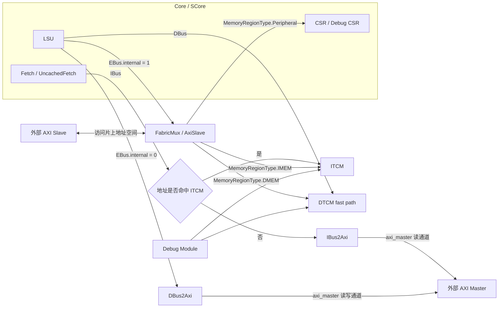

# Coral Matrix Extension 笔记

## 当前进度

- 已完成 matrix 参数初版配置
  - 已在 `hdl/chisel/src/coralnpu/Parameters.scala` 中加入 `enableMatrix / matrixElen / matrixTlen / matrixTrlen` 等参数
- 已完成 matrix 配置指令第一版 Decode 改造
  - 已在 `hdl/chisel/src/coralnpu/scalar/Decode.scala` 中加入 `msettilemi/msettilem/msettileki/msettilek/msettileni/msettilen`
  - 已加入 `isMatrixCfg / isMatrixCfgImm / isMatrixCfgReg`
  - 已将 matrix config 指令并入 `forceSlot0Only()`
  - 已新增 `matrixCfg` dispatch 通路，当前先通过 `MatrixCfgCmd(op)` 区分 `SET_M / SET_K / SET_N`
  - 已让 `msettile*i` immediate 形式通过 `rs1Set` 注入 `uimm10`，统一为后端可直接读取的 `rs1.data`
  - 已让 `matrixCfg` 与 CSR 一样要求 `retirement_buffer_empty` 后再发射，避免全局 matrix 配置状态乱序可见

## 下一步计划

1. 先冻结 Coral matrix v1 的最小范围
   - 第一版只做 `matrix CSR + 1 条 matrix 指令通路 + 1 个 MatrixUnit 占位实现`
   - 暂时不直接改 `RVV` generated Verilog
   - 暂时不先改 GCC / binutils
2. 继续改 CSR
   - 在 `hdl/chisel/src/coralnpu/scalar/Csr.scala` 中加入 matrix 配置寄存器
   - 先把 `xmcsr / mtilem / mtilen / mtilek / xmisa / xtlenb / xtrlenb / xalenb` 这批 CSR 立起来
   - 新增 `CsrMatrixIO` 或 `matrixCfg` 输入端口，把 `Decode.scala` 中的 `matrixCfg` 通路真正接入 CSR
   - 先让 `msettile*` 能更新 `mtilem / mtilek / mtilen`
3. 再建立独立 matrix 执行通路
   - 新建 `hdl/chisel/src/coralnpu/matrix/MatrixInterface.scala`
   - 新建 `hdl/chisel/src/coralnpu/matrix/MatrixUnit.scala`
   - 把当前 `matadd` 从 `ALU` 过渡到 `MatrixUnit`
4. 最后补最小验证闭环
   - CSR 读写测试
   - `msettile*` 的 Decode / Dispatch 测试
   - 一条 matrix 指令的执行测试

## Matrix Decode 阶段记录（已完成）

这一阶段的目标不是先把矩阵 CSR 或 MatrixUnit 完整做完，而是先把 matrix 配置指令在前端识别清楚，并为后续 `Csr.scala` 接线准备好统一的 dispatch 语义。

当前已在 `hdl/chisel/src/coralnpu/scalar/Decode.scala` 中完成这些工作：

- 新增矩阵配置指令识别：
  - `msettilemi / msettilem`
  - `msettileki / msettilek`
  - `msettileni / msettilen`
- 新增辅助判断函数：
  - `isMatrixCfg()`
  - `isMatrixCfgImm()`
  - `isMatrixCfgReg()`
- 将矩阵配置指令纳入 `forceSlot0Only()`，保证它们只从 `slot0` 发射
- 在 `Dispatch` 接口中新增：
  - `matrixCfg : Valid[MatrixCfgCmd]`
- 目前通过 `MatrixCfgCmd.op` 区分三种配置目标：
  - `SET_M`
  - `SET_K`
  - `SET_N`

### Decode 设计原则

这一版 Decode 的关键策略是：

- `msettilem/msettilek/msettilen`
  - 把参数看作来自真实寄存器 `rs1`
- `msettilemi/msettileki/msettileni`
  - 不额外新建一套 immediate 数据通路
  - 而是复用现有 `rs1Set` 机制，把 `uimm10` 直接注入为 `rs1.data`

这样做的目的，是让后端看到统一的数据接口：

```text
matrixCfg.op  决定修改 M / K / N
rs1.data      决定写入的新值
```

也就是说，后续 `Csr.scala` 不需要区分：

- 这是寄存器形式
- 还是立即数形式

只需要读统一的 `rs1.data` 即可。

### 时序与顺序约束

由于 `msettile*` 修改的是全局 matrix 配置状态：

- `mtilem`
- `mtilen`
- `mtilek`

所以这一版已经让它和普通 CSR 一样，要求在 `retirement_buffer_empty` 时才能发射。这样可以避免后续矩阵 load/store/compute 接进来后，出现旧指令看到新 tile 配置的乱序问题。

当前使用的约束思路是：

```text
普通指令：不要求 ROB 为空
CSR / MatrixCfg：要求 ROB 为空
```

### 当前阶段的边界

这一步只完成了“前端识别 + 发射分类”，还没有完成：

- `SCore.scala` 中 `matrixCfg` 到 `CSR` 的接线
- `Csr.scala` 中 `mtilem / mtilek / mtilen` 的真实更新
- `xmcsr / xmisa / xtlenb / xtrlenb / xalenb` 的 CSR 建立
- `MatrixUnit` 的数据执行路径

因此现在可以把这一阶段理解为：

- matrix 配置指令已经“有名字、有分类、有发射出口”
- 但还没有真正“落到 CSR 状态里生效”

## 相关代码结构

### SCore 总体框图

如果你接下来要改的是 `hdl/chisel/src/coralnpu/scalar/SCore.scala`，最先要建立的认识是：

- `SCore` 不是单个执行单元
- `SCore` 是标量核这一侧的“总装层”
- 它负责把 `Fetch / Dispatch / Regfile / CSR / LSU / BRU / ALU / MLU / DVU / RetirementBuffer / FaultManager / Debug`
  全部接起来

下面这张图适合先建立“模块之间谁连谁”的整体感觉：

```text
                           +---------------------- SCore ----------------------+
                           |                                                   |
                           |   +--------+      +-----------+                   |
      ibus --------------->|   | Fetch  |----->| Dispatch  |------------------+----+
                           |   +--------+      +-----------+                  |    |
                           |        ^                 |                        |    |
                           |        |                 | rs1/rs2 addr/set       |    |
                           |        |                 v                        |    |
                           |        |            +-----------+                 |    |
                           |        |            | Regfile   |<----------------+    |
                           |        |            +-----------+      writeback        |
                           |        |                 ^                              |
                           |        |                 |                              |
                           |        |                 |                              |
                           |   flush/jump        +---------+                         |
                           |<--------------------| BRU     |                         |
                           |                     +---------+                         |
                           |                                                   +-----v------+
                           |                     +---------+                    | Retirement |
                           |-------------------->| ALU xN  |                    | Buffer     |
                           |                     +---------+                    +------------+
                           |                     +---------+
                           |-------------------->| MLU     |
                           |                     +---------+
                           |                     +---------+
                           |-------------------->| DVU     |
                           |                     +---------+
                           |                     +---------+
      dbus / ebus <------->|<------------------->| LSU     |
                           |                     +---------+
                           |                                                   +------------+
                           |   CSR req / debug req      trap / state / frm --->| CSR        |
                           |--------------------------->+------------+          +------------+
                           |                            |            |<--- BRU / Float / RVV
                           |                            +------------+
                           |
                           |   dispatch fault / fetch fault / lsu fault / rvv trap
                           |---------------------------> +--------------+
                           |                             | FaultManager |
                           |                             +--------------+
                           |
                           |   optional:
                           |   FloatCore / FRegfile
                           |   RvvCore
                           |   Debug tap
                           +-----------------------------------------------------------+
```

可以把 `SCore` 粗略分成 6 件事：

- `Fetch`
  从 `ibus` 取指，把指令和 PC 送进 `Dispatch`
- `Dispatch`
  做前端分发，决定一条指令进入 `ALU / BRU / LSU / CSR / MLU / DVU / Float / RVV` 的哪一路
- `Regfile`
  提供 `rs1/rs2` 数据，并接收执行单元写回
- `CSR`
  保存架构状态，例如 `mepc/mcause/mstatus`，也负责和 `BRU / Float / RVV / Debug` 交互
- `执行单元`
  包括 `ALU / BRU / LSU / MLU / DVU`，可选再接 `FloatCore / RvvCore`
- `RetirementBuffer + FaultManager`
  负责退休顺序、精确异常、trap 汇总和状态一致性

### CSR 连接关系速览

下面这张 ASCII 图适合在开始改 `hdl/chisel/src/coralnpu/scalar/Csr.scala` 前先记住。它表达的是当前 Coral 里 `Csr` 模块的主要输入、输出和上下游关系。

```text
                           +----------------------------------+
                           |           CoreAxiCSR             |
                           |  csr.in[0]  <- pcStart           |
                           |  csr.out[0..8] -> 外部可读寄存器 |
                           +----------------+-----------------+
                                            |
                                            | CsrInOutIO
                                            v
 +----------------+   csr.valid/bits   +----+-----------------------------------+   trace   +-----------+
 |   DispatchV2   | -----------------> |                CSR                      | --------> | RvviTrace |
 +----------------+                    |                                            |           +-----------+
                                       |  req   : CSR 访问请求                     |
 +----------------+   csr cmd / rs1    |  rs1   : 写 CSR 的源操作数               |  rd.data
 |  Debug Module  | -----------------> |  rd    : CSR 读结果                      | --------> +--------------+
 |    (DM)        | <----------------- |  dm    : debug_req / resume_req / step   | <-------- | Debug Module |
 +----------------+      csr_rd        |                                            |           +--------------+
                                       |  bru   : 异常、陷入、mepc/mtvec/mode      |
 +----------------+        rs1         |  float : frm / fflags   (可选)            |
 |    Regfile     | -----------------> |  rvv   : vstart/vl/vtype/... (可选)       |
 |                | <----------------- |  irq   : 外部中断输入                     |
 +----------------+      rd回写        |  counters : nRetired                      |
                                       +----+------------------+-------------------+
                                            ^                  ^
                                            |                  |
                                            | bru              | counters.nRetired
                                            |                  |
                                      +-----+-----+      +-----+---------------+
                                      |   BRU(0)  |      |  RetirementBuffer   |
                                      +-----------+      +---------------------+

      +------------------+                                     +----------------------+
      | Fetch/Uncached   | -- fetch.pc -----------------------> | csr.in[12]           |
      | FetchControl     |                                      | 当前取指 PC sideband |
      +------------------+                                     +----------------------+

      +------------------+                                     +----------------------+
      |    FloatCore     | <---------- float ----------------> | CSR.float            |
      |   (enableFloat)  |                                     +----------------------+
      +------------------+

      +------------------+                                     +----------------------+
      |     RvvCore      | <----------- rvv -----------------> | CSR.rvv              |
      |    (enableRvv)   |                                     +----------------------+
      +------------------+

      +------------------+
      |   Top / SCore    |
      | halted/fault/wfi |
      | irq              |
      +--------+---------+
               ^
               |
               +---------------------- CSR 输出流水线状态
```

读这张图时可以先抓住 4 条主线：

- `DispatchV2 / Debug Module` 负责发起 CSR 访问请求，最终都汇入 `CSR.req`
- `Regfile` 给 `CSR.rs1` 提供写操作数，`CSR.rd` 再把读结果回写回去
- `BRU(0)` 负责和 `CSR` 交换异常、陷入和跳转控制相关状态
- `FloatCore / RvvCore / RetirementBuffer / Fetch / CoreAxiCSR` 都是给 `CSR` 提供“状态”或消费“配置”的外围模块

### CoreAxi / 总线速览

下面这张图可以把 `Fetch / LSU / ITCM / DTCM / AXI` 的主连接关系先记住。它对应的是当前仓库里最常见的 `CoreAxi` 路径。



读这张图时，可以顺手把参数分成 3 类：

- `axi0*`
  主要对应 `L1ICache.scala` 这一类 instruction-side cache 接口参数。
- `axi1*`
  主要对应 `L1DCache.scala` 这一类 data-side cache 接口参数。
- `axi2*`
  是当前 `CoreAxi` 主路径里最活跃的一组参数，贯穿 `ITCM / DTCM / SRAM wrapper / Fabric / AxiSlave / IBus2Axi / DBus2Axi / axi_{slave,master}`。

也就是说，当前默认 `CoreAxi` 路径更适合先记成：

- `Fetch -> IBus -> ITCM 命中直读，未命中走 IBus2Axi -> axi_master`
- `LSU -> DBus -> DTCM`
- `LSU -> EBus -> (Peripheral 走 Fabric/AxiSlave, External 走 DBus2Axi -> axi_master)`

## matadd 实验记录

`matadd` 自定义指令第一版实现的详细记录，已经从这里拆分到独立文档：

- [matadd.md](./matadd.md)

这里保留主线结论：

- `matadd` 第一版已经完成最小闭环验证
- 后续不再继续把矩阵语义堆在普通 `ALU` 里
- 下一阶段转入独立 `MatrixUnit + CSR + Decode/Dispatch` 主线

## 在 Coral 中实现矩阵扩展的计划表

当前最适合的思路不是一开始就改 RVV 大核，也不是先并编译器，而是先在 Coral 标量前端里增加一套独立的 `matrix extension` 通路，再逐步向玄铁矩阵扩展靠拢。

### 实施原则

- 先做 `subset`，不要第一版就追完整 Xuantie matrix spec
- 先做 RTL + CSR + 最小指令闭环，再考虑 toolchain / intrinsic
- 不修改 generated RVV 大文件，优先改 Chisel 源码
- 不把矩阵操作长期塞在普通 `ALU` 里，要单独建 `MatrixUnit`

### 第一版目标

第一版建议只做一个可运行、可验证、可扩展的最小子集：

- 输入数据最大先支持到 `16bit`
- 累加输出先按 `32bit` 设计
- 固定参数：
  - `ELEN = 32`
  - `TLEN = 256`
  - `TRLEN = 64`
- 先实现 matrix CSR：
  - `xmcsr`
  - `mtilem`
  - `mtilen`
  - `mtilek`
  - `xmisa`
  - `xtlenb`
  - `xtrlenb`
  - `xalenb`
- 先实现 matrix 指令子集：
  - `msettilem`
  - `msettilen`
  - `msettilek`
  - `mld`
  - `mst`
  - `mmacc`
- `matadd` 先从“普通 ALU 占位操作”逐步迁到独立 matrix 通路

### 当前参数配置为什么这样选

当前 Coral matrix v1 准备采用下面这组实现参数：

```scala
var enableMatrix = false
val matrixElen = 32
val matrixTlen = 256
val matrixTrlen = 64

def matrixRowNum: Int = { matrixTlen / matrixTrlen }
def matrixArlen: Int = { matrixRowNum * matrixElen }
def matrixAlen: Int = { matrixArlen * matrixRowNum }

val matrixTileRegCount = 4
val matrixAccRegCount = 4

def matrixTlenBytes: Int = { matrixTlen / 8 }
def matrixTrlenBytes: Int = { matrixTrlen / 8 }
def matrixAlenBytes: Int = { matrixAlen / 8 }
```

根据 spec，矩阵扩展的三个基础实现参数是：

- `ELEN` 表示矩阵操作可生产或消费的最大元素位宽
- `TLEN` 表示单个 tile register 的总位宽
- `TRLEN` 表示 tile register 单行位宽

spec 还定义了三个由它们推导出来的量：

- `ROWNUM = TLEN / TRLEN = 256 / 64 = 4`
- `ARLEN = (TLEN / TRLEN) * ELEN = 4 * 32 = 128`
- `ALEN = ARLEN * ROWNUM = 128 * 4 = 512`

因此当前硬件含义就是：

- tile register 总宽度 `256bit`
- tile register 每行 `64bit`
- tile register 一共 `4` 行
- accumulation register 每行 `128bit`
- accumulation register 总宽度 `512bit`

这组参数和计划中的 `4x4` 脉动阵列正好能自然对齐。

如果输入元素最大是 `16bit`：

- tile 每一行可放 `64 / 16 = 4` 个元素
- 一共有 `4` 行
- 所以一个 source tile 正好就是 `4 x 4`

如果输出累加元素按 `32bit`：

- accumulation 每一行可放 `128 / 32 = 4` 个元素
- 一共有 `4` 行
- 所以一个 accumulation tile 也正好就是 `4 x 4`

也就是说，这套参数可以直接支撑下面这个映射：

- `4 x 4` tile 输入块进入脉动阵列
- `4 x 4` accumulation tile 保存输出块
- `mtilem / mtilen / mtilek` 的第一版最大目标值都可以先收敛到 `4`

为什么 `matrixTileRegCount` 和 `matrixAccRegCount` 都先定成 `4`：

- spec 的程序模型就是 `4` 个 tile registers `tr0-tr3`
- 以及 `4` 个 accumulation registers `acc0-acc3`
- load/store 语义里也默认 tile index 是 `0-3`，acc index 是 `4-7`

这组参数还能直接映射到只读 CSR：

- `xtlenb = 256 / 8 = 32`
- `xtrlenb = 64 / 8 = 8`
- `xalenb = 512 / 8 = 64`

所以，当前这套配置的本质不是“完全照搬 Xuantie 某个现成实现”，而是在遵守其参数模型的前提下，为 Coral 第一版 `4x4`、`16bit` 输入、`32bit` 累加的脉动阵列原型做的最小收敛选择。

### 现有可复用入口

当前 Coral 已经有几个很好的挂点：

- 参数开关入口：
  - `hdl/chisel/src/coralnpu/Parameters.scala`
- CSR 解码与状态保存：
  - `hdl/chisel/src/coralnpu/scalar/Csr.scala`
- 自定义指令 decode：
  - `hdl/chisel/src/coralnpu/scalar/Decode.scala`
- 当前 `matadd` 占位实现：
  - `hdl/chisel/src/coralnpu/scalar/Alu.scala`
- 标量核心拼装：
  - `hdl/chisel/src/coralnpu/scalar/SCore.scala`
- 顶层拼装：
  - `hdl/chisel/src/coralnpu/Core.scala`

所以路线应该是：

- 先加 `enableMatrix`
- 再加 matrix CSR
- 再加 `MatrixUnit`
- 再把 `matadd` 和后续 matrix 指令接进去

### 分阶段计划

#### 当前优先开工顺序

如果现在就要开始动手，建议严格按下面顺序推进：

1. `Parameters.scala`
   - 增加 `enableMatrix`
   - 增加 `matrixElen / matrixTlen / matrixTrlen`
2. `Csr.scala`
   - 增加 matrix CSR 状态
   - 先让软件能配置 tile 形状和能力位
3. `matrix/MatrixInterface.scala`
   - 定义 `MatrixCmd / MatrixConfigState / FaultInfo`
4. `matrix/MatrixUnit.scala`
   - 先做空壳
   - 只要求能收命令、返回完成、保留扩展接口
5. `Decode.scala`
   - 把 `matadd` 从“ALU 占位操作”改成“matrix 通路入口”
6. `SCore.scala`
   - 实例化并接入 `MatrixUnit`
7. 测试
   - 先补 CSR 测试
   - 再补 decode / dispatch 测试
   - 最后补一条最小 matrix 指令执行测试

#### P0：冻结第一版规范

目标：

- 定义 Coral matrix v1 的最小兼容范围
- 明确第一版只做 Xuantie matrix `subset`

需要输出：

- 一份设计文档，建议新增 `doc/matrix_plan.md`

文档至少写清：

- CSR 列表
- 指令列表
- tile / acc 寄存器模型
- 异常策略
- 第一版不支持的内容

#### P1：增加 matrix 参数开关

目标：

- 在参数系统里正式引入 matrix extension

建议修改：

- `hdl/chisel/src/coralnpu/Parameters.scala`

建议增加：

- `enableMatrix`
- `matrixElen`
- `matrixTlen`
- `matrixTrlen`
- `matrixTileRegCount`
- `matrixAccRegCount`

建议默认值：

- `enableMatrix = false`
- `matrixElen = 32`
- `matrixTlen = 256`
- `matrixTrlen = 64`
- `matrixTileRegCount = 4`
- `matrixAccRegCount = 4`

验收标准：

- 代码可 elaboration
- 顶层可以通过参数打开或关闭 matrix

#### P2：增加 matrix CSR 配置面

目标：

- 让软件可以读写 matrix 配置状态

建议修改：

- `hdl/chisel/src/coralnpu/scalar/Csr.scala`

建议做法：

- 新增 Xuantie 风格 matrix CSR 地址和状态寄存器
- 第一版允许 CSR 直接读写 `mtilem / mtilen / mtilek`
- `KISA` 中加入 matrix capability bit

建议第一版 CSR：

- `xmcsr`
- `mtilem`
- `mtilen`
- `mtilek`
- `xmisa`
- `xtlenb`
- `xtrlenb`
- `xalenb`

验收标准：

- 软件可通过 `csrr/csrw` 正常访问 matrix CSR
- 仿真中可以观察到 CSR 状态变化

#### P3：建立独立 matrix 接口

目标：

- 不再把 matrix 扩展长期混在 `ALU` 语义里

建议新增目录：

- `hdl/chisel/src/coralnpu/matrix/`

建议新增文件：

- `MatrixInterface.scala`

第一版建议定义：

- `MatrixConfigState`
- `MatrixCmd`
- `TileRegWriteDataIO`
- `AccRegWriteDataIO`
- `MatrixFaultInfo`

验收标准：

- matrix 通路的接口独立成型
- 不依赖 RVV 内部实现细节

#### P4：扩展 Decode

目标：

- 在 decode 中正式识别 matrix 指令

建议修改：

- `hdl/chisel/src/coralnpu/scalar/Decode.scala`

建议增加：

- `isMatrix()`
- `writesMatrixReg()`
- `readsMatrixReg()`
- `isMatrixLoadStore()`

并新增第一版指令识别：

- `msettilem`
- `msettilen`
- `msettilek`
- `mld`
- `mst`
- `mmacc`

当前已有：

- `matadd`

建议：

- 把 `matadd` 作为 matrix 通路的过渡入口

验收标准：

- matrix 指令不落到 `undef`
- dispatch 能把 matrix 指令分到独立端口

#### P5：建立 MatrixUnit 空壳

目标：

- 先把 matrix 执行通路搭起来

建议新增：

- `hdl/chisel/src/coralnpu/matrix/MatrixUnit.scala`

第一版空壳功能：

- 接收 `MatrixCmd`
- 接收 `MatrixConfigState`
- 输出 `ready / valid / busy / trap`
- 先不做复杂计算

验收标准：

- `SCore` 能实例化 `MatrixUnit`
- matrix 指令可进入该单元

#### P6：在 SCore / Core 中接线

目标：

- 把 matrix unit 真的接入 Coral

建议修改：

- `hdl/chisel/src/coralnpu/scalar/SCore.scala`
- `hdl/chisel/src/coralnpu/Core.scala`

需要完成：

- dispatch 到 matrix unit 的连接
- 标量寄存器读操作数连接
- matrix fault 接入 fault manager
- 结果回写路径接入 retirement / regfile

验收标准：

- 顶层可综合 elaboration
- 波形中能看到 matrix 指令通过独立通路传播

#### P7：实现 tile / accumulator 寄存器文件

目标：

- 建立真正的矩阵状态存储

建议新增：

- `MatrixRegfile.scala`

第一版建议：

- `4` 个 tile 寄存器
- `4` 个 accumulator 寄存器

验收标准：

- CSR 与指令可以正确影响 tile shape
- tile / acc 数据可被读写

#### P8：实现 matrix load/store

目标：

- 支持矩阵数据在 DTCM 和 tile reg 之间搬运

建议新增：

- `MatrixLoadStore.scala`

建议策略：

- 第一版尽量复用现有 LSU / DTCM 通路
- 不一开始新做一套复杂总线协议

第一版支持：

- `mld`
- `mst`

验收标准：

- 可把 DTCM 数据装载进 tile reg
- 可把 tile reg 数据写回 DTCM

#### P9：实现最小计算 datapath

目标：

- 完成第一版真正有意义的矩阵算子

建议新增：

- `MatrixMac.scala`

第一版功能建议只做：

- `int32 mmacc`

验收标准：

- 能完成最小矩阵乘加
- 和软件 golden model 对比一致

#### P10：异常与状态管理

目标：

- 定义 matrix extension 的 fault 行为

建议处理：

- 非法 tile shape
- CSR 配置非法
- busy 冲突
- 未初始化 tile 访问
- 非法 matrix opcode

建议修改：

- `matrix/*`
- `scalar/FaultManager.scala`

验收标准：

- 非法使用时 fault 行为稳定且可重复

#### P11：软件 bring-up

目标：

- 先不依赖完整编译器，先把软件闭环跑起来

第一版建议：

- 继续使用 `.insn`
- 手写 matrix 汇编
- 先生成 `elf/bin/vmem`

建议测试内容：

- CSR 读写程序
- `msettile*` 程序
- `mld/mst` 程序
- `mmacc` 程序

验收标准：

- 能从 bare-metal 程序驱动 matrix CSR 和 matrix 指令

#### P12：工具链接入

目标：

- 在 RTL 跑通后，再考虑玄铁工具链能力

建议顺序：

1. 先接 `binutils/opcodes/objdump`
2. 再考虑 intrinsic
3. 最后考虑 GCC backend

注意：

- 建议“并入流程”，不要直接把整套 GCC 源码塞进 Coral 仓库
- 更适合把玄铁工具链作为外部工具链使用

验收标准：

- 汇编器能识别 matrix 指令
- `objdump` 能正确反汇编

#### P13：RTL 导出与综合

目标：

- 把 matrix 版本纳入现有 RTL 导出与综合流

需要完成：

- 增加带 matrix 开关的 emit 目标
- 增加 matrix 版本 Verilog 导出
- 更新综合脚本

验收标准：

- 能导出带 matrix 的 RTL
- 能进入综合流程

### 建议实施顺序

最适合现在马上开始的顺序是：

1. 写 `matrix_plan.md`，冻结第一版范围
2. 修改 `Parameters.scala`
3. 修改 `Csr.scala`
4. 新建 `matrix/MatrixInterface.scala`
5. 修改 `Decode.scala`
6. 新建 `matrix/MatrixUnit.scala`
7. 修改 `SCore.scala`
8. 修改 `Core.scala`
9. 写最小 CSR / decode / dispatch 测试

### 第一周目标

第一周建议只追求这几个结果：

- `enableMatrix` 参数加入系统
- matrix CSR 能读写
- matrix 指令能 decode
- `MatrixUnit` 空壳能接入顶层
- 仿真中能看到 matrix 指令进入独立通路

不要第一周就追：

- 完整 tile load/store
- 完整 `mmacc`
- GCC backend

### 第二周目标

- tile / acc regfile
- `msettilem/n/k`
- `mld / mst`
- 最小 `mmacc`

### 不建议的路线

- 不建议第一步直接改 generated RVV `.sv`
- 不建议第一步就并入完整玄铁 GCC
- 不建议长期把 matrix 逻辑继续塞在 `Alu.scala`
- 不建议第一版就追 full Xuantie ISA

### 里程碑

- `M1`：CSR 与 decode 打通
- `M2`：MatrixUnit 空壳接入完成
- `M3`：tile load/store 跑通
- `M4`：`mmacc` 计算正确
- `M5`：bare-metal 程序可驱动
- `M6`：RTL 可导出并可综合

### 玄铁工具什么时候用

玄铁矩阵扩展仓库里，当前最常见会接触到的三类工具/组件是：

- `spec/`
  规范文档
- `qemu/`
  模拟器 / 参考行为模型
- `xuantie-gnu-toolchain/riscv-binutils-gdb`
  汇编器、链接器、反汇编器、调试器
- `xuantie-gnu-toolchain/riscv-gcc`
  C/C++ 编译器

建议不要一开始就把这些都拉进 Coral 主开发路径，而是按阶段使用。

#### 当前阶段：只需要规范，不急着用工具链

如果当前目标是：

- 设计 Coral matrix extension 架构
- 增加 CSR
- 增加 decode
- 增加 `MatrixUnit`
- 先跑通最小 RTL 闭环

那么只需要重点看：

- `spec/csr.adoc`
- `spec/program_model.adoc`
- `spec/tilereg.adoc`

这个阶段可以暂时不用：

- `riscv-gcc`
- `riscv-binutils-gdb`
- `qemu`

也就是说，当前阶段主目标是“先把硬件接口和行为定下来”。

#### RTL 初步跑通后：开始用 qemu

当以下内容已经基本确定后：

- matrix CSR 已定义
- matrix 指令编码已冻结第一版
- tile / acc 模型已确定

这时开始看 `qemu/` 最有价值。

用途：

- 跑 matrix 程序
- 作为参考模型
- 对比 Coral 仿真结果
- 帮助检查指令和 CSR 行为是否合理

注意：

- `qemu` 不是用来替代 RTL 仿真的
- 它更像软件侧参考模型

#### 需要写助记符汇编时：开始用 binutils

当你不想一直用 `.insn`，而希望：

- 写 matrix 指令助记符
- 正确反汇编 ELF
- 检查编码和反汇编结果

这时开始看：

- `xuantie-gnu-toolchain/riscv-binutils-gdb`

这个阶段最有用的是：

- `as`
- `objdump`
- `ld`

也就是说，`binutils` 是在“软件可用性提升阶段”开始变得重要，而不是第一周必须接入。

#### 需要 intrinsic / C 编译支持时：再看 gcc

只有当下面这些都基本稳定后：

- matrix ISA 子集已经确定
- CSR 命名和行为不再频繁变化
- load/store / mmacc 已经跑通
- 你准备让 C 代码直接调用 matrix 能力

这时才应该开始看：

- `xuantie-gnu-toolchain/riscv-gcc`

主要目标：

- intrinsic
- builtin
- 编译器生成 matrix 指令

这个阶段成本最高，不建议提前做。

#### 当前结论

对当前 Coral matrix extension 项目，建议优先级是：

1. 先看 `spec/`
2. 先做 Coral RTL 和 CSR
3. 再看 `qemu`
4. 再看 `binutils`
5. 最后才看 `gcc`

一句话说：

- 规范现在就用
- `qemu` 在 RTL 第一版成型后用
- `binutils` 在想摆脱 `.insn` 时用
- `gcc` 在想支持 intrinsic / 自动编译时再用

### 外部参考

- Xuantie matrix CSR:
  - `https://github.com/XUANTIE-RV/riscv-matrix-extension-spec/blob/master/spec/csr.adoc`
- Xuantie programmer model:
  - `https://github.com/XUANTIE-RV/riscv-matrix-extension-spec/blob/master/spec/program_model.adoc`
- Xuantie tile / accumulator model:
  - `https://github.com/XUANTIE-RV/riscv-matrix-extension-spec/blob/master/spec/tilereg.adoc`

## 附：Coral 工程入门

Coral 工程入门、结构定位和通用使用说明已移到：

- [coral_intro.md](./coral_intro.md)
